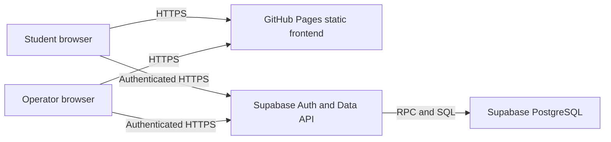
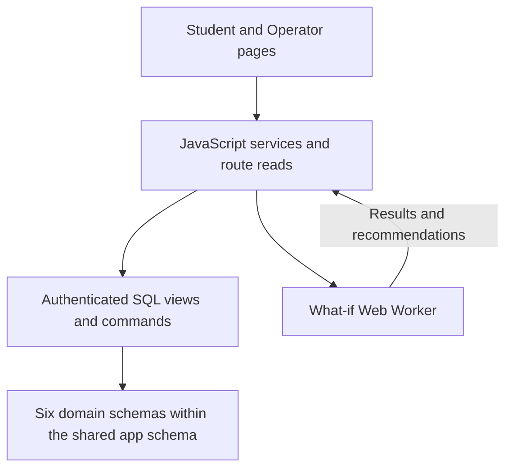

# Final MVP architecture

## Deployment

The hosted project uses one shared demo dataset. Both browsers open the same HTML/CSS/JavaScript app directly. Each browser establishes an anonymous Supabase session automatically and polls views for the selected demo portal. No live device telemetry is required. The Operator submits identified simulated events.

## Development

SQL commands use one transaction to recheck and change shared resources. The simulation captures a versioned copy before computation and only writes its own result. Details are in the [database setup](DATABASE_SETUP.md) and [shared contracts](SHARED_CONTRACTS.md).
