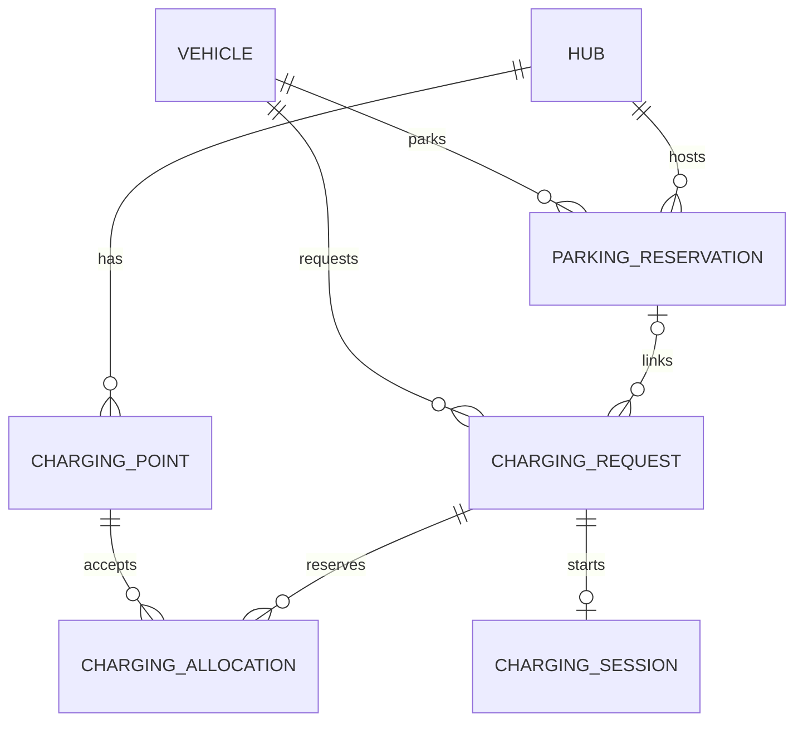

# Shared implementation contracts

The Final MVP uses Supabase PostgreSQL. See [database setup](DATABASE_SETUP.md) for setup and release, and the [implementation guide](README.md) for module ownership and demo flows. Submissions 1–3 describe the course design and business rules.

## Runtime and identity

- Keep one GitHub Pages entry point with Student and Operator shells and hash routes. Feature pages mount using `mount(root, { store, api, viewer })` and return a cleanup function. Here `store` holds the screen's latest read result in memory. The database is the authoritative source.
- Supabase Auth provides authenticated identities. `app.profiles` links an Auth UUID to an existing business user ID and role. Every RPC derives ownership from the authenticated session. Changing the route or browser state cannot grant Operator privileges.
- Screens read via `api.read(view, filter)` and re-read every five seconds while visible, on return to the tab and after successful writes. Each read returns the demo time and revision. Keep loading, unavailable and empty states distinct.
- `api.command(operation, payload, commandId)` uses a UUID per action. PostgreSQL serializes demo writes using the shared state row and retains successful receipts by caller, operation and key. Matching retries return the original result. A different payload with the same key fails.
- GitHub Pages serves the static frontend. Supabase hosts authentication and SQL. App tables are in the unexposed `app` schema. RPCs granted to authenticated clients check roles and ownership. Keep administrative credentials outside browser code and Git.

## Data model

- Identity and Hubs own `profiles` and `hubs`. `vehicles` has one row per shared or private vehicle, with shared IDs referenced across all modules.
- Rentals use `rental_reservations` and `rental_trips`. Parking uses `parking_spaces`, `parking_reservations`, `parking_reservation_slots` and `parking_sessions`.
- Charging uses `charging_points`, `charging_requests`, `charging_schedules`, `charging_allocations`, `charging_sessions` and `notifications`.
- Fleet uses `redistribution_orders`, `redistribution_order_vehicles`, `incident_tickets`, `resource_restrictions` and `telemetry_events`.
- What-if keeps `what_if_scenarios`, `simulation_snapshots`, `simulation_runs`, `simulation_results` and `simulation_recommendations` separate from live operation. `demo_state` and `command_receipts` coordinate time, revisions and safe retries.

Typical relationships follow this path:

The allocation history may contain past rows. Partial unique indexes allow one unreleased allocation per point and request, and one open request per vehicle.

## RPC catalogue

Both endpoints return `{ ok: true, data }` or `{ ok: false, code }`. The client adds friendly error text and maps SQL field names to camel case. The SQL files are authoritative for operation payloads.

- **Reads:** `app_view(p_view, p_filter)` supports `bootstrap`, `hubs`, `network`, `rental`, `parking`, `parking.review`, `charging`, `fleet`, `incidents` and `simulation`. Overview data exposed to students is aggregate or owned data.
- **Rental and Parking:** `rental.reserve/pickup/cancel/return`, `parking.reserve/checkIn/cancel/checkOut`. Confirm parking capacity across the entire window. Shared-vehicle return, transfer arrival and checkout reconcile physical occupancy through the owner transaction.
- **Charging:** `charging.submit/cancel/stop/adjust/event`. A Student draft references its parking booking, Hub and vehicle. PostgreSQL reads the current battery and vehicle type. If a compatible point is available now, return `Scheduled`; if all compatible points are unavailable, return `Waiting`, `Full` and the Hub queue position; for a future start, return `Waiting` with `FutureStart`. Estimates and planned end are informational. A point is held for 15 minutes without a verified start. Release, timeout or recovery can promote the next eligible request.
- **Fleet:** `fleet.create/dispatch/arrive/cancel`, `incident.report/investigate/resolve/close`, `telemetry.point/vehicle`. Arrival confirms one vehicle, and only that vehicle's confirmed destination changes. A healthy sample does not remove an incident restriction. Resolve one incident per operation.
- **Simulation and demo controls:** `simulation.configure/start/complete/fail`, `identity.profile`, `demo.advance/reset`. Simulation reads a copied baseline and writes only simulation records. Advancing the demo clock reconciles parking, rental and charging expiry in the same transaction.

The shared seed starts at 09:00 ICT on 24 October 2026, with 5 Hubs and 60 charging points. Each Hub has 8 motorcycle and 4 car points. Rent and charging remain free in the MVP.
