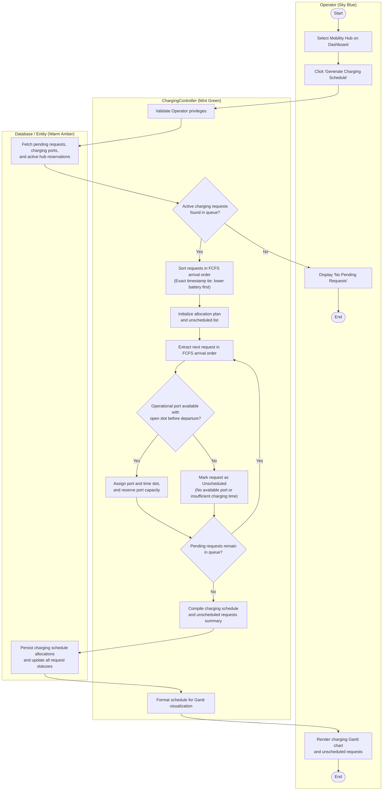
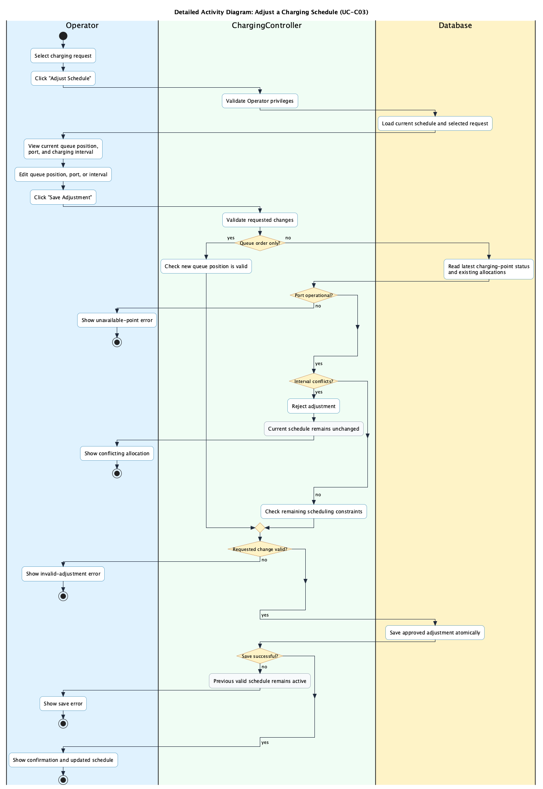

# ACTIVITY DIAGRAMS — MODULE 5: SMART CHARGING SCHEDULING

**Responsible Member:** Member 5 (Smart Charging Scheduling)  
**Deliverables Directory:** [docs/submission-2/activity-diagrams/smart-charging/](.)

---

## 1. Summary of Deliverables

- **Inside-Diamond Questions**: All branching questions are placed directly inside the quadrilateral/diamond decision shape (`conditionStyle insideDiamond`).
- **UML Node Shapes**: `if` and `repeat while` conditions render as decision diamonds. Normal activities use strongly rounded action rectangles; nodes marked `<<status>>` use lightly rounded status rectangles.
- **Centered Layout**: Nodes in each column are aligned along their vertical center axes.
- **Distinct Pastel Swimlane Colors**: Column 1 in Sky Blue (`#E0F2FE`), Column 2 in Mint Green (`#F0FDF4`), Column 3 (Entity/Database) in Warm Amber (`#FEF3C7`).

| Diagram Name | Linked Use Case | PlantUML Source | Rendered PNG Image |
| :--- | :--- | :--- | :--- |
| **`AD_GenerateChargingSchedule_FCFS`** | [UC-C02: Generate a Charging Schedule](../../../submission-1/use-case-scenarios/smart_charging_scheduling.md#L64) | [AD_GenerateChargingSchedule_FCFS.puml](AD_GenerateChargingSchedule_FCFS.puml) | [AD_GenerateChargingSchedule_FCFS.png](AD_GenerateChargingSchedule_FCFS.png) |
| **`AD_AdjustChargingSchedule`** | [UC-C03: Adjust a Charging Schedule](../../../submission-1/use-case-scenarios/smart_charging_scheduling.md#L159) | [AD_AdjustChargingSchedule.puml](AD_AdjustChargingSchedule.puml) | [AD_AdjustChargingSchedule.png](AD_AdjustChargingSchedule.png) |

---

## 2. Interactive Preview (Mermaid)

## 3. Manual Schedule Adjustment (UC-C03)

