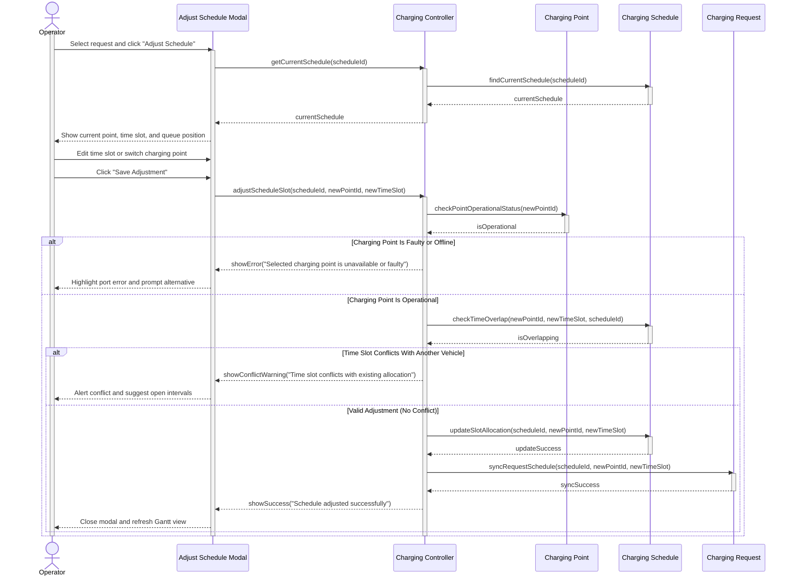

# SEQUENCE DIAGRAMS — MODULE 5: SMART CHARGING SCHEDULING

**Responsible Member:** Member 5 (Smart Charging Scheduling)  
**Deliverables Directory:** [docs/submission-2/sequence-diagrams/smart-charging/](.)

---

## 1. Summary of Deliverables

All sequence diagrams feature:
- **Color-Coded BCE Boxes**:
  - **Boundary UI**: Soft Sky Blue (`#E0F2FE`)
  - **Controller**: Soft Mint Green (`#F0FDF4`)
  - **Entities (`Charging Request`, `Charging Point`, `Charging Schedule`)**: Soft Warm Amber (`#FEF3C7`)
- **Blue Lifelines**: Activation boxes and lines styled in Electric Blue (`#0284C7` border, `#BAE6FD` fill).
- **Open-Stick Return Arrows (`-->>`)**: Standard 3-segment open arrows without filled triangle heads.
- **Scheduling Policy**: First-Come, First-Served (FCFS) by request submission timestamp. Only exact timestamp ties use lower battery level first.

| Diagram Name | Linked Use Case | Source Code | Rendered PNG Image |
| :--- | :--- | :--- | :--- |
| **`SD_ViewChargingQueue`** | [UC-C01: View Charging Queue and Schedule](../../../submission-1/use-case-scenarios/smart_charging_scheduling.md#L1) | [SD_ViewChargingQueue.puml](SD_ViewChargingQueue.puml) | [SD_ViewChargingQueue.png](SD_ViewChargingQueue.png) |
| **`SD_GenerateChargingSchedule`** | [UC-C02: Generate a Charging Schedule (FCFS)](../../../submission-1/use-case-scenarios/smart_charging_scheduling.md#L64) | [SD_GenerateChargingSchedule.puml](SD_GenerateChargingSchedule.puml) | [SD_GenerateChargingSchedule.png](SD_GenerateChargingSchedule.png) |
| **`SD_AdjustChargingSchedule`** | [UC-C03: Adjust a Charging Schedule](../../../submission-1/use-case-scenarios/smart_charging_scheduling.md#L162) | [SD_AdjustChargingSchedule.puml](SD_AdjustChargingSchedule.puml) | [SD_AdjustChargingSchedule.png](SD_AdjustChargingSchedule.png) |

---

## 2. Interactive Previews (Mermaid)

### 2.1. `SD_ViewChargingQueue` (UC-C01)

```mermaid
sequenceDiagram
    actor Op as Operator
    participant UI as Charging Dashboard UI
    participant Ctrl as Charging Controller
    participant Req as Charging Request
    participant Point as Charging Point
    participant Sched as Charging Schedule

    activate Op
    Op->>UI: Click "View Queue & Schedule"
    activate UI
    UI->>Ctrl: getQueueAndSchedule(hubId)
    activate Ctrl

    Ctrl->>Req: findPendingRequests(hubId)
    activate Req
    Req-->>Ctrl: pendingRequests
    deactivate Req

    Ctrl->>Point: getChargingPointsStatus(hubId)
    activate Point
    Point-->>Ctrl: chargingPointsList
    deactivate Point

    Ctrl->>Sched: getCurrentSchedule(hubId)
    activate Sched
    Sched-->>Ctrl: currentSchedule
    deactivate Sched

    alt Database Connection Failure
        Ctrl-->>UI: showError("Failed to retrieve charging data")
        UI-->>Op: Display error alert
    else Data Retrieved Successfully
        Ctrl->>Ctrl: sortPendingBySubmissionTime(pendingRequests)
        Note over Ctrl: FCFS; lower battery first only for equal timestamps
        Ctrl->>Ctrl: identifyUnscheduledRequests(pendingRequests, currentSchedule)
        Ctrl-->>UI: displayQueueAndSchedule(sortedPendingRequests, currentSchedule, chargingPointsList)
        UI-->>Op: Render schedule Gantt chart, port status, and waiting queue
    end
    deactivate Ctrl
    deactivate UI
    deactivate Op
```

---

### 2.2. `SD_GenerateChargingSchedule` (UC-C02) — FCFS Policy

```mermaid
sequenceDiagram
    actor Op as Operator
    participant UI as Charging Dashboard UI
    participant Ctrl as Charging Controller
    participant Req as Charging Request
    participant Point as Charging Point
    participant Sched as Charging Schedule

    activate Op
    Op->>UI: Click "Generate Schedule"
    activate UI
    UI->>Ctrl: generateChargingSchedule(hubId)
    activate Ctrl

    Ctrl->>Req: getPendingRequests(hubId)
    activate Req
    Req-->>Ctrl: requestList or retrievalError
    deactivate Req

    Ctrl->>Point: getAvailablePoints(hubId)
    activate Point
    Point-->>Ctrl: availablePoints or retrievalError
    deactivate Point

    alt Request or charging-point retrieval failed
        Ctrl-->>UI: showError("Charging data unavailable")
        UI-->>Op: Display error; keep previous schedule
    else Charging data retrieved
    Note over Ctrl: FCFS by submission time; lower battery only on exact tie
    Ctrl->>Ctrl: sortQueueBySubmissionTime(requestList)

    Note over Ctrl: Slot Allocation (FCFS Order)
    loop for each request in arrival order
        Ctrl->>Ctrl: findFeasiblePointAndSlot(request, availablePoints)
        alt Feasible Port & Time Found
            Ctrl->>Ctrl: assignSlot(request, pointId, timeInterval)
        else Port Busy or Insufficient Time
            Ctrl->>Ctrl: markUnscheduled(request, reason)
        end
    end

    Ctrl->>Sched: saveNewSchedule(generatedSchedule)
    activate Sched

    alt Database Save Failure
        Sched-->>Ctrl: saveFailed
        deactivate Sched
        Ctrl-->>UI: showError("Failed to save schedule")
        UI-->>Op: Display error alert
    else Save Succeeded
        Sched-->>Ctrl: saveSuccess
        deactivate Sched

        Ctrl->>Req: updateRequestStatuses(scheduledList, unscheduledList)
        activate Req
        Req-->>Ctrl: updateSuccess
        deactivate Req

        Ctrl-->>UI: displayResult(generatedSchedule, unscheduledList)
        UI-->>Op: Update Gantt chart and unscheduled requests
    end
    end
    deactivate Ctrl
    deactivate UI
    deactivate Op
```

---

### 2.3. `SD_AdjustChargingSchedule` (UC-C03)


