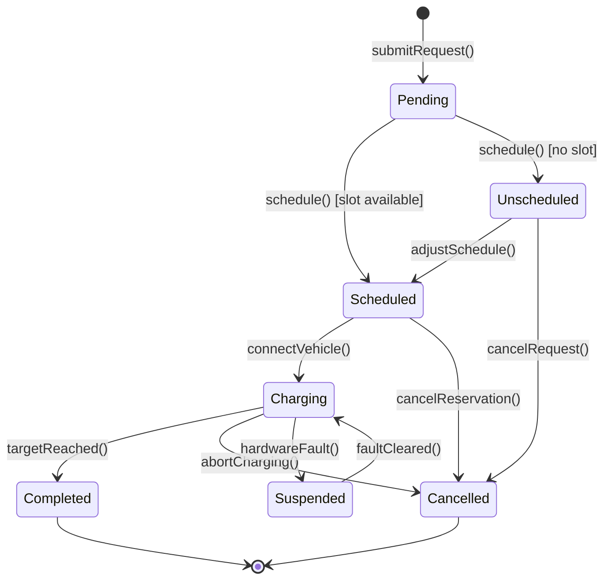

# STATE MACHINE DIAGRAMS — MODULE 5: SMART CHARGING SCHEDULING

**Responsible Member:** Member 5 (Smart Charging Scheduling)  
**Deliverables Directory:** [docs/submission-2/state-chart-diagrams/smart-charging/](.)

---

## 1. Summary of Deliverables

Biểu đồ mô tả chi tiết máy trạng thái hữu hạn và toàn bộ vòng đời (Lifecycle) của thực thể trọng tâm trong phân hệ lập lịch sạc: **`ChargingRequest`**.

| Diagram Name | Entity | PlantUML Source | Rendered PNG Image |
| :--- | :--- | :--- | :--- |
| **`STM_ChargingRequest_Lifecycle`** | `ChargingRequest` | [STM_ChargingRequest_Lifecycle.puml](STM_ChargingRequest_Lifecycle.puml) | [STM_ChargingRequest_Lifecycle.png](STM_ChargingRequest_Lifecycle.png) |

---

## 2. Giải thích: "Message đi cùng mũi tên gọi là gì?"

Trong chuẩn đặc tả UML 2.5 (State Machine Diagram), đoạn chữ/thông điệp đi kèm mũi tên chuyển trạng thái được gọi là:
* **Tiếng Anh:** **Transition Label** (hoặc **Transition Specification**).
* **Tiếng Việt:** **Nhãn chuyển trạng thái** (hoặc **Sự kiện kích hoạt chuyển trạng thái**).

### Cú pháp chuẩn UML 2.5:
$$\text{trigger} \ [\text{guard}] \ / \ \text{effect}$$

* **`trigger` (Event):** Tên sự kiện hoặc phương thức kích hoạt (ví dụ: `submitRequest()`, `connectVehicle()`, `abortCharging()`).
* **`[guard]` (Điều kiện bảo vệ):** Biểu thức logic Boolean đặt trong ngoặc vuông `[...]`. Quá trình chuyển trạng thái chỉ xảy ra khi điều kiện này thỏa mãn `true` (ví dụ: `[slot available]`, `[no slot]`).
* **`/ effect` (Action):** Tác vụ thực thi tức thời trong lúc chuyển trạng thái (đã được lược giản ngắn gọn để biểu đồ thông thoáng, trực quan nhất).

---

## 3. Kiến trúc luồng trạng thái (Layout Architecture)

Biểu đồ tuân thủ nguyên tắc định hướng trực giao (Strict Orthogonal):

```
                  [*]
                   │
                   ▼ (submitRequest)
Trục chính         Pending ────────────► Unscheduled (Nhánh rẽ: hết slot trước giờ đi)
(Tiến trình thuận: │                       │
Đi thẳng đứng)     ▼ (schedule [slot])     │ (adjustSchedule)
                Scheduled ◄────────────────┘
                   │                       │
                   │ (connectVehicle)      │ (cancelRequest)
                   ▼                       ▼
  Suspended ◄── Charging ───────────► Cancelled (Nhánh rẽ: tài xế hủy / timeout)
(Lỗi phần cứng)    │   (abortCharging)     │
                   │                       │
                   │ (targetReached)       │
                   ▼                       │
               Completed ──────────────────┘
                   │
                   ▼
                  [*]
```

### Nguyên tắc bố cục:
1. **Trục chính thẳng đứng (Happy Path Spine):**
   * Chuỗi trạng thái thành công hoàn chỉnh: `[*] ➔ Pending ➔ Scheduled ➔ Charging ➔ Completed ➔ [*]`.
   * Tất cả mũi tên đi xuống đều là đường thẳng đứng 100%, không bị xiên xẹo hay gãy khúc.
2. **Nội dung bên trong State Box:**
   * Mỗi trạng thái giữ lại các hành vi vòng đời UML 2.5 chuẩn (`entry /`, `do /`, `exit /`) súc tích, vừa vặn (2–3 dòng), không bị quá dài và không bị trống rỗng.
3. **Phân luồng nhánh rẽ ngang (Positive / Negative Branches):**
   * **Nhánh tiếp nhận:** Nếu không còn slot trống trước giờ xe cần đi, rẽ ngang sang phải vào `Unscheduled`. Khi có slot trống được giải phóng, rẽ ngang sang trái quay lại `Scheduled`.
   * **Nhánh ngoại lệ phần cứng:** Từ `Charging` rẽ ngang sang trái sang `Suspended` (màu hổ phách). Khi khắc phục xong, rẽ ngang sang phải quay lại `Charging` (màu xanh lá).
   * **Nhánh hủy / dừng khẩn cấp:** `abortCharging()` được hiển thị nổi bật bằng **đường thẳng ngang màu đỏ đậm (`#DC2626`)** nối thẳng từ `Charging` sang `Cancelled`.

---

## 4. Biểu đồ tương tác (Mermaid Preview)



---

## 5. Bảng định nghĩa trạng thái & Hành vi nội tại (UML 2.5)

| State | Pastel Color | Ý nghĩa nghiệp vụ | Hành vi vòng đời (`entry` / `do` / `exit`) |
| :--- | :--- | :--- | :--- |
| **`Pending`** | Soft Blue (`#E0F2FE`) | Yêu cầu sạc mới được tiếp nhận, xếp hàng chờ lập lịch. | **`entry /`** Enqueue in FCFS arrival queue<br>**`do /`** Await scheduling cycle |
| **`Scheduled`** | Soft Indigo (`#E0E7FF`) | Đã xếp lịch, gán cổng sạc và giữ chỗ công suất. | **`entry /`** Assign portId & time slot<br>**`entry /`** Reserve electrical capacity<br>**`exit /`** Unlock reserved capacity |
| **`Charging`** | Mint Green (`#D1FAE5`) | Đang cắm sạc tại cổng và truyền điện vào pin xe. | **`entry /`** Lock connector & engage relay<br>**`do /`** Monitor battery SOC & power<br>**`exit /`** Open relay & calculate energy |
| **`Completed`** | Soft Green (`#DCFCE7`) | Nạp pin hoàn tất, mở khóa cổng và chốt hóa đơn. | **`entry /`** Unlock connector & release port<br>**`entry /`** Finalize transaction & billing |
| **`Unscheduled`** | Warm Amber (`#FEF3C7`) | Hết cổng sạc hoặc không đủ thời gian sạc trước giờ đi. | **`entry /`** Log exclusion reason<br>**`do /`** Await capacity release |
| **`Suspended`** | Soft Rose (`#FFE4E6`) | Tạm ngắt truyền điện do sự cố kỹ thuật trụ sạc. | **`entry /`** Open relay & raise alert<br>**`do /`** Await hardware diagnostics |
| **`Cancelled`** | Light Slate (`#F1F5F9`) | Phiên sạc bị hủy (hủy đặt chỗ, timeout, hoặc abort). | **`entry /`** Release allocated resources<br>**`entry /`** Notify driver via app |

---

## 6. Ma trận chuyển trạng thái (State Transition Matrix)

| State hiện tại | Transition Label (Event + Guard) | State tiếp theo | Hướng & Kiểu dáng mũi tên |
| :--- | :--- | :--- | :--- |
| `[*]` | `submitRequest()` | **`Pending`** | Đi thẳng xuống |
| **`Pending`** | `schedule() [slot available]` | **`Scheduled`** | Đi thẳng xuống |
| **`Pending`** | `schedule() [no slot]` | **`Unscheduled`** | Rẽ ngang sang phải |
| **`Unscheduled`** | `adjustSchedule()` | **`Scheduled`** | Rẽ ngang sang trái |
| **`Unscheduled`** | `cancelRequest()` | **`Cancelled`** | Đi thẳng xuống |
| **`Scheduled`** | `connectVehicle()` | **`Charging`** | Đi thẳng xuống |
| **`Scheduled`** | `cancelReservation()` | **`Cancelled`** | Rẽ ngang sang phải |
| **`Charging`** | `targetReached()` | **`Completed`** | Đi thẳng xuống |
| **`Charging`** | `hardwareFault()` | **`Suspended`** | Rẽ ngang sang trái (Màu cam) |
| **`Suspended`** | `faultCleared()` | **`Charging`** | Rẽ ngang sang phải (Màu xanh) |
| **`Charging`** | `abortCharging()` | **`Cancelled`** | Rẽ ngang sang phải (**Đỏ đậm `#DC2626`**) |
| **`Completed`** | Cleanup | **`[*]`** | Đi thẳng xuống |
| **`Cancelled`** | Cleanup | **`[*]`** | Đi thẳng xuống |
